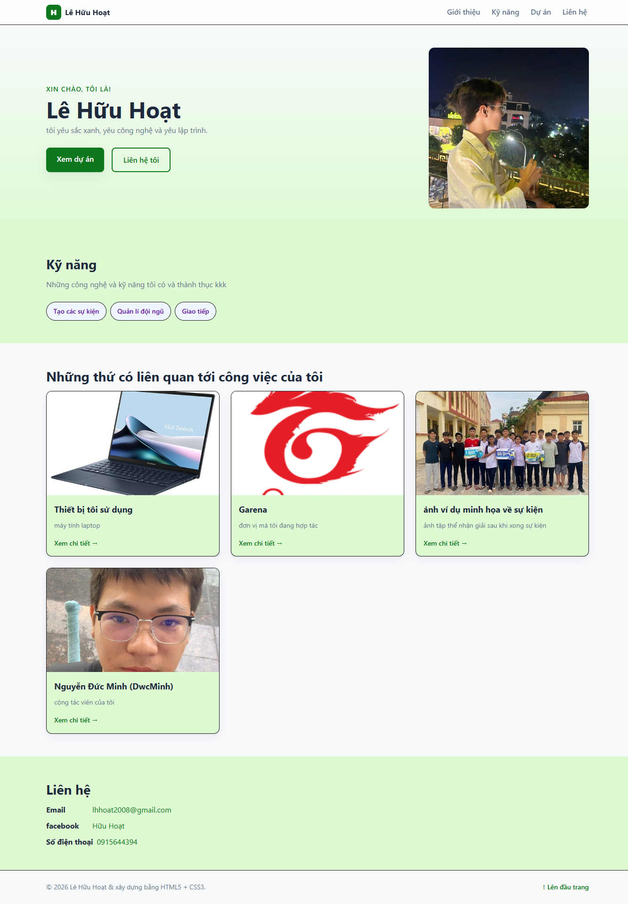
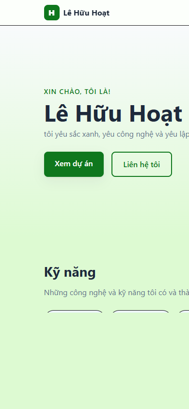

# Báo cáo kiểm thử

- **Dự án:** Portfolio cá nhân Lê Hữu Hoạt
- **Ngày kiểm thử:** 27/10/2026
- **Phạm vi:** Kiểm tra thủ công trang tĩnh `index.html` trên Chromium tích hợp; mở trực tiếp bằng `file://` và chạy qua HTTP cục bộ.
- **Kết quả chung:** Đạt một phần. Các phần nội dung chính hoạt động; còn lỗi hiển thị trên màn hình nhỏ và một số liên kết chưa hoàn thiện.

## 1. Tính đúng đắn — Đạt

- Xác nhận trang hiển thị đúng tiêu đề, các mục Giới thiệu, Kỹ năng, Dự án, Liên hệ và chân trang.
- Thử bấm lần lượt 4 liên kết điều hướng; cả 4 đều chuyển đến đúng mục tương ứng.
- Cả 5/5 ảnh trên trang tải thành công và có văn bản thay thế (`alt`).
- **Còn tồn tại:** phát hiện 3 liên kết dùng `href="#"`, gồm liên kết của một thẻ nội dung, email và số điện thoại; các liên kết này chưa thực hiện hành động như người dùng mong đợi.

## 2. UI/UX — Đạt một phần

- Giao diện máy tính hiển thị đầy đủ phần giới thiệu, kỹ năng, thẻ nội dung và liên hệ.
- Ở viewport điện thoại **390 × 844 px**, dòng mô tả phần giới thiệu bị cắt ở mép phải. `overflow-x: hidden` trên trang che phần tràn thay vì làm nội dung tự xuống dòng.
- Cần điều chỉnh bố cục màn hình nhỏ và kiểm tra lại khả năng đọc, điều hướng trên điện thoại trước khi phát hành.

**Ảnh minh chứng:**

## 3. Khả năng vận hành - xử lý lỗi — Đạt một phần

- Mở trang trực tiếp và qua HTTP cục bộ đều hiển thị được.
- Kiểm tra yêu cầu HTTP cho trang HTML, tệp CSS và 5 ảnh: **7/7 tài nguyên trả mã 200**.
- Đây là website tĩnh, không có JavaScript, backend hoặc luồng nhập liệu động; do đó không có xử lý lỗi nghiệp vụ phía trình duyệt để kiểm thử.
- Chưa có cơ chế dự phòng khi tệp ảnh bị thiếu; cần bảo đảm các tài nguyên được triển khai đúng đường dẫn.

## 4. Bảo mật — Đạt cơ bản, chưa kiểm thử chuyên sâu

- Rà soát mã nguồn: không thấy JavaScript, biểu mẫu nhập liệu, backend hoặc thư viện bên thứ ba được nhúng vào trang.
- Website không xử lý dữ liệu người dùng; các thông tin liên hệ được công khai trực tiếp trong HTML.
- Chưa kiểm tra cấu hình bảo mật HTTP như HTTPS, Content Security Policy hoặc các security headers trên máy chủ triển khai thực tế. Đây không phải kết quả kiểm thử xâm nhập hay đánh giá bảo mật toàn diện.

## 5. Chất lượng mã nguồn — Đạt cơ bản

- Nội dung HTML và giao diện CSS được tách riêng; trang sử dụng các phần tử cấu trúc như `header`, `nav`, `main`, `section`, `article` và `footer`.
- Các ảnh hiện có đều có thuộc tính `alt`; không phát hiện script hoặc bước biên dịch trong trang.
- Chưa chạy công cụ lint, validator HTML/CSS hay bộ kiểm thử tự động; repository hiện không khai báo các công cụ này.
- Nên hoàn thiện các liên kết `#` và kiểm tra lại nội dung hiển thị trên màn hình nhỏ.

## 6. Khả năng triển khai — Đạt ở mức thử nghiệm cục bộ

- Trang tĩnh và các tài nguyên tương đối tải được qua HTTP cục bộ; không cần bước build.
- README có hướng dẫn phục vụ bằng máy chủ Python hoặc Nginx/Docker.
- Chưa chạy thử Docker/Nginx và chưa triển khai lên môi trường production; HTTPS, cấu hình máy chủ, đường dẫn sau triển khai và security headers chưa được xác minh.

## Môi trường và giới hạn kiểm thử

- **Trình duyệt:** Chromium tích hợp.
- **Kích thước ảnh:** máy tính 1333 × 1917 px (toàn trang); điện thoại 390 × 844 px.
- Các ảnh trong `docs/screenshots/` được chụp trực tiếp từ trang đang chạy trong trình duyệt trong quá trình kiểm thử.
- Kết quả chỉ phản ánh phiên bản và môi trường được kiểm tra ngày 27/10/2026; chưa bao gồm kiểm thử trên nhiều trình duyệt, thiết bị thật, trình đọc màn hình hoặc môi trường triển khai công khai.